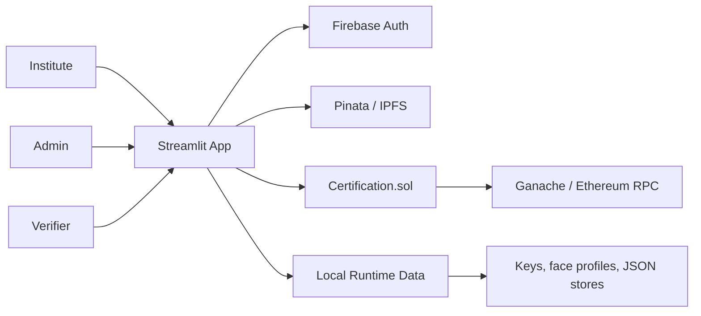

# BlockCert

> Blockchain-backed digital certificate issuance and verification with Streamlit, Truffle, Firebase auth, IPFS, QR validation, Merkle proofs, and optional face matching.

## Overview

BlockCert is a role-based certificate platform for institutes, verifiers, and admins.

It combines:

- Ethereum smart contracts for certificate, batch, institute, and revocation state.
- Streamlit for the application UI.
- Firebase Authentication for login and role claims.
- Pinata/IPFS for document storage.
- QR codes, Merkle proofs, Bloom filter checks, and digital signatures for layered verification.
- Optional face-profile enrollment and matching for stronger holder validation.

## What The Project Does

| Role | Capabilities |
| --- | --- |
| Institute | Register, wait for admin approval, issue single or bulk certificates, upload to IPFS, encrypt files, enroll face data, download certificates and QR bundles |
| Admin | Review institutes, approve or reject certificates, approve revocations, participate in multi-signer blockchain approvals |
| Verifier | Verify by certificate ID or QR, validate blockchain data, inspect signature status, check Bloom and Merkle proofs, optionally verify a face match |

## Architecture At A Glance



## Main Components

- `application/`: Streamlit app, authentication, verification logic, QR helpers, encryption helpers, Merkle utilities, Bloom filter, face matching.
- `contracts/`: Solidity smart contracts.
- `migrations/`: Truffle deployment scripts.
- `build/`: generated contract artifacts after compilation.
- `deploy_contracts.py`: compile, migrate, and write deployment address to `deployment_config.json`.
- `setup_admin.py`: helper for admin setup workflows.

## Public Repo Hygiene

This repository is configured so local-only or sensitive files stay out of Git, including:

- environment files and API secrets
- Firebase service account credentials
- generated encryption keys and institute signer mappings
- local certificate state stores, face profiles, and cached models
- generated reports, archives, and non-primary markdown notes

Only `README.md` is kept as the public markdown entrypoint.

## Prerequisites

Install these before running the project:

- Python 3.10 or newer
- Node.js 18 or newer
- Ganache CLI or Ganache Desktop
- Truffle

Recommended global Node installs:

```bash
npm install -g truffle ganache-cli
```

## Python Dependencies

Create a virtual environment and install the app dependencies:

```bash
python -m venv .venv
.venv\Scripts\activate
pip install -r requirements.txt
```

## Environment Configuration

Create a root `.env` file with the values used by Firebase, Pinata, and local crypto settings:

```env
FIREBASE_API_KEY=your_firebase_api_key
FIREBASE_AUTH_DOMAIN=your-project.firebaseapp.com
FIREBASE_DATABASE_URL=https://your-project-default-rtdb.firebaseio.com
FIREBASE_PROJECT_ID=your-project-id
FIREBASE_STORAGE_BUCKET=your-project.appspot.com
FIREBASE_MESSAGING_SENDER_ID=your_sender_id
FIREBASE_APP_ID=your_app_id
PINATA_API_KEY=your_pinata_api_key
PINATA_API_SECRET=your_pinata_api_secret
MASTER_KEY_PASSWORD=choose-a-strong-password
FACE_MATCH_THRESHOLD=0.55
FACE_MATCH_MARGIN=0.07
FACE_MIN_PIXELS=80
```

Add your Firebase Admin SDK service account file here:

```text
application/serviceAccountKey.json
```

## Admin Signer Configuration

Admin signer emails are defined in `application/utils/admin_config.py`.

Those emails map to the first Ganache accounts and participate in the contract's approval threshold logic. If you change them, keep the email list aligned with the Ganache accounts you intend to use.

## How To Run

### 1. Start Ganache

```bash
ganache-cli -h 127.0.0.1 -p 8545
```

### 2. Deploy the smart contracts

From the project root:

```bash
python deploy_contracts.py
```

This compiles the Solidity contracts, migrates them with Truffle, and writes the deployed contract address to `deployment_config.json`.

### 3. Launch the Streamlit app

```bash
cd application
streamlit run app.py
```

Open the local Streamlit URL shown in the terminal.

## Typical Local Workflow

1. Start Ganache.
2. Deploy or redeploy contracts.
3. Launch Streamlit from the `application` directory.
4. Register admin, institute, and verifier accounts in Firebase.
5. Verify institute accounts from the admin flow.
6. Issue certificates and verify them using certificate ID or QR.

## Notes About Runtime Files

- `deployment_config.json` is generated locally after deployment.
- Face recognition models are downloaded automatically on first use into `application/models/`.
- Encryption keys, signer mappings, and face profiles are stored locally and are intentionally ignored by Git.
- `build/contracts/` must exist for the Streamlit app to connect to the deployed contract ABI.

## Troubleshooting

- If the app cannot find the contract, redeploy and confirm `deployment_config.json` exists at the project root.
- If login works but admin actions fail, verify your admin email list matches `application/utils/admin_config.py`.
- If Firebase auth fails, re-check `.env` values and `application/serviceAccountKey.json`.
- If face verification fails on first use, allow the ONNX models to finish downloading.
- If blockchain transactions revert, confirm Ganache is running on `127.0.0.1:8545` and the expected accounts are available.

## Repository Layout

```text
BlockCert/
├── application/        # Streamlit application
├── contracts/          # Solidity contracts
├── migrations/         # Truffle migrations
├── build/              # Generated contract artifacts
├── deploy_contracts.py # Deployment helper
├── truffle-config.js   # Truffle network/compiler config
└── README.md           # Public project overview
```

## Tech Stack

- Python
- Streamlit
- Solidity
- Truffle
- Ganache
- Web3.py
- Firebase Auth
- Pinata / IPFS
- OpenCV
- Cryptography